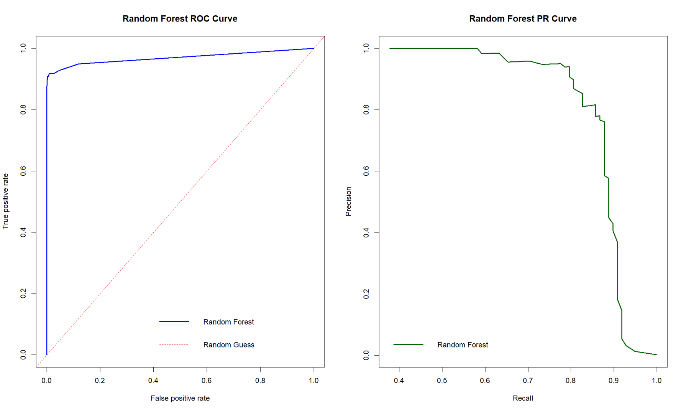
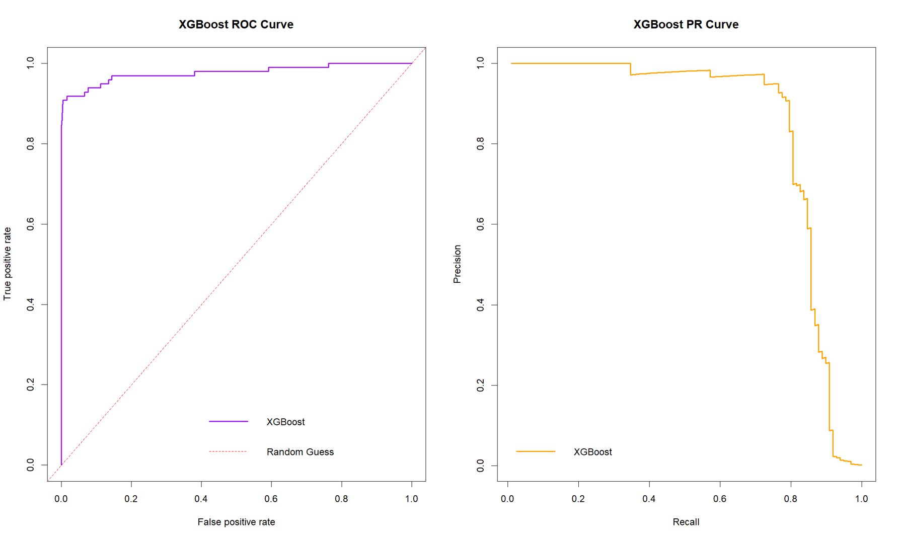

# fraud-detector
Bank fraud detector that uses highly unbalanced datasets to find fraud using Scikit.learn Machine Learning and Random Forest.

This specific model uses SMOTE (to create samples to allow for balancing for accuracy) and RandomForest models. We also used XGBoost, but overtime, I deemed RandomForest far more reliable for this purpose.

Below are the ROC (Receiver Operating Characteristic) and PR (Precision Recall) curves for both models. For this specific repository, I put each one separately, then combined both to show the difference:

ROC and PR curves tell us two things:
- How many fraud cases were caught for every false positive? (ROC)
- How accurate was the model? (PR)

These charts should provide you with an understanding of why RF was used: it is more accurate, more reliable, and generally far better at detection.
